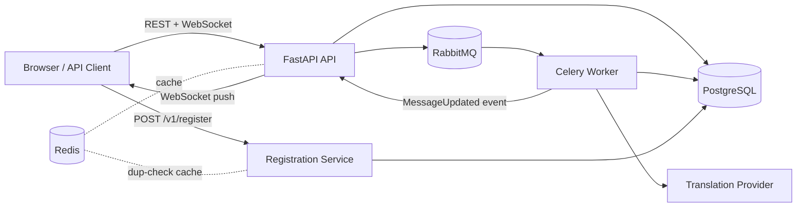
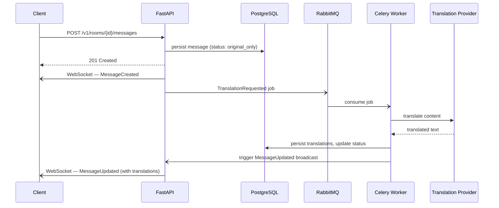

# Prism

Prism is a real-time chat platform where messages are automatically translated server-side so every participant reads the conversation in their own language — without any delay to the sender.

When a message is sent, it is delivered immediately to all connected clients. Translation runs asynchronously in the background and is pushed to every client as a live update the moment it completes. If the translation provider is unavailable, the message stays readable in the original language and the status is surfaced to the UI — the chat never blocks.


> When the LLM provider is unavailable, the message is still delivered in the original language and the translation status is shown.
>
> 

---

## Architecture



**User identity is split across two linked tables**, not one:

- `public.users` — the room/message identity (`display_name`, `preferred_lang`); referenced by rooms, memberships, and messages.
- `auth.accounts` — registration credentials (`email`, `username`, `password_hash`), isolated in its own Postgres schema and owned by the registration service.

`auth.accounts.id` is a foreign key to `users.id` (shared primary key, 1:1) rather than one merged table, because:

- Credentials stay isolated from general chat data in a schema that can be locked down independently.
- Users register once but send many messages — `auth.accounts` stays small and rarely written/read compared to `users`/`messages`, so keeping it separate avoids bloating or contending with the hot chat tables.
- `users.id` stays the single stable identity referenced by rooms/messages regardless of how auth is implemented later.

## Message flow



**When the translation provider is unavailable:** steps 1–5 still execute — the message is delivered in the original language. The worker retries, then marks the message `translation_unavailable` and pushes a status update. Chat is never blocked.

The API and worker are fully decoupled. The worker only writes to Postgres and fires an update event back through the gateway. The translation model can be swapped via config without touching application logic.

---

## Stack

| Layer | Technology |
|---|---|
| API + WebSocket | FastAPI (Python 3.12) |
| Registration service | FastAPI, standalone from the API |
| Task queue | Celery + RabbitMQ |
| Session / pub-sub | Redis |
| Database | PostgreSQL + Alembic |
| Password hashing | bcrypt |
| Containerisation | Docker Compose |

---

## Quick start

> Secrets stay local. The repo tracks only `.env.example` — copy it to `.env` and never commit the result.

**1. Create your local env file**

```bash
cp .env.example .env
```

**2. Set your translation provider in `.env`**

```env
TRANSLATION_PROVIDER=openrouter
TRANSLATION_MODEL=openai/gpt-4.1-mini
TRANSLATION_FALLBACK_PROVIDER=openai
TRANSLATION_FALLBACK_MODEL=gpt-4.1-mini
OPENROUTER_API_KEY=your_key_here
```

> If port 8000 is already in use, set `API_PORT` in `.env` to a free port (e.g. `8010`).

**3. Start the database and infrastructure dependencies**

```bash
docker compose -f deploy/compose/docker-compose.yml up -d postgres rabbitmq redis
```

**4. Run database migrations**

```bash
docker compose -f deploy/compose/docker-compose.yml run --rm api alembic -c migrations/alembic.ini upgrade head
```

**5. Start the application services**

```bash
docker compose -f deploy/compose/docker-compose.yml up --build
```

**6. Open the webui**

Navigate to `http://localhost:8000/` — the welcome page links to **Log in** or **Register**.
Register an account, log in, then create or join a room from the dashboard. From there you can
send messages, change your default language (Settings), and — if you're a room's owner — see
live message/translation/cost stats in that room.

### Authentication and admin access

After migrations are applied, the API creates a built-in account on startup if it does not
already exist:

- Username: `admin`
- Initial password: `password123` (override with `ADMIN_INITIAL_PASSWORD` before first startup)
- Email: `admin@prism.local`

The first successful admin login requires setting a new password before the app issues a
session. The `admin` username is reserved from public registration. The initial password is a
known default: set a unique `ADMIN_INITIAL_PASSWORD` before exposing any deployment. This
setting is used only when the account is first created; changing it later does not reset an
existing account's password.

Browser sessions use `HttpOnly`, `Secure`, `SameSite=Lax` cookies for access and refresh
tokens. Tokens and user IDs are not passed in page URLs or WebSocket query strings.
Cookie-authenticated state-changing requests and WebSocket handshakes validate their `Origin` against
`CORS_ALLOWED_ORIGINS`; set that allowlist to the exact public app origin in deployed
environments. `AUTH_COOKIE_SECURE` defaults to `true`. Non-browser API clients may continue to
use `Authorization: Bearer`; query-string tokens are not accepted.

Global operational endpoints under `/v1/admin` require the caller's ID in `ADMIN_USER_IDS`
(default: `admin`). Set this to a JSON list, for example `ADMIN_USER_IDS=["admin","user-id"]`.
Room metrics and room-management operations continue to require admin membership in the
specific room.

| Page | URL |
|---|---|
| Welcome (login / register) | `http://localhost:8000/` |
| Register | `http://localhost:8000/ui/register` |
| Login | `http://localhost:8000/ui/login` |
| Dashboard (create/join room) | `http://localhost:8000/ui` |
| Room chat | `http://localhost:8000/ui/rooms/{room_id}` |

**7. Verify the API**

```bash
curl http://localhost:8000/v1/health
```

**Optional: seed demo data**

```bash
docker compose -f deploy/compose/docker-compose.yml run --rm api python -m scripts.bootstrap_dev
```

This creates a demo user, a demo room, and an admin membership so you can start testing immediately instead of creating everything by hand.

---

## Docker command reference

| What | Command |
|---|---|
| Start (foreground) | `docker compose -f deploy/compose/docker-compose.yml up --build` |
| Start (detached) | `docker compose -f deploy/compose/docker-compose.yml up --build -d` |
| Stop | `docker compose -f deploy/compose/docker-compose.yml down` |
| Stop + wipe volumes | `docker compose -f deploy/compose/docker-compose.yml down -v` |
| Run migrations | `docker compose -f deploy/compose/docker-compose.yml run --rm api alembic -c migrations/alembic.ini upgrade head` |
| Run tests | `docker compose -f deploy/compose/docker-compose.yml run --rm tests` |
| API logs | `docker compose -f deploy/compose/docker-compose.yml logs -f api` |
| Worker logs | `docker compose -f deploy/compose/docker-compose.yml logs -f worker` |
| Registration service logs | `docker compose -f deploy/compose/docker-compose.yml logs -f registration` |

**Creating a new migration after schema changes:**

```bash
docker compose -f deploy/compose/docker-compose.yml run --rm api \
  alembic -c migrations/alembic.ini revision --autogenerate -m "describe_change"
docker compose -f deploy/compose/docker-compose.yml run --rm api \
  alembic -c migrations/alembic.ini upgrade head
```

---

## Running tests

```bash
# Docker (recommended)
docker compose -f deploy/compose/docker-compose.yml run --rm tests

# Local
pip install -r requirements.txt
pytest -q tests/unit
```

---

## Project status

Room/message analytics (`/v1/admin/rooms/{room_id}/metrics`) and basic observability (structured logging, correlation IDs, queue/translation latency metrics, distributed tracing) are implemented and available today — see below.

**Working now:**
- Room creation and membership management
- User profiles with per-user language preferences
- Standalone registration service (`POST /v1/register`) for email/username/password sign-up, with credentials stored in a separate Postgres schema (`auth.accounts`) linked to `users` by shared primary key, and a duplicate-check cache in Redis
- Message send, persistence, and WebSocket fan-out to all room subscribers
- Async translation via configurable LLM provider with live `MessageUpdated` push
- Graceful degradation — provider failures mark the message `translation_unavailable` and push a status update without breaking chat
- Retry policy with dead-letter queue handling for permanently failed translation jobs
- Reconnect-safe room history replay
- Room admin metrics and analytics summary endpoint (queue delay, translation latency, cost breakdowns)
- Structured logging with request correlation IDs across API and worker
- Lightweight distributed tracing — trace/span context propagated from HTTP requests through Celery into the worker, instrumenting message, room, websocket, and admin request paths plus translation job execution
- Rate limiting, daily quotas, and abuse protection (per-user/per-room message limits, room creation limits, websocket connection caps) with an admin violation-visibility endpoint
- Input validation and payload size limits
- Browser authentication with secure HttpOnly cookies, refresh rotation, logout revocation, and Origin validation
- Default admin bootstrap with mandatory initial password change and allowlist-protected global admin endpoints
- Seed / dev bootstrap script for quick local QA setup
- Docker-first local dev with Postgres, RabbitMQ, Redis, API, and worker

**Planned / not yet built:**
- Redis pub/sub fan-out across multiple API replicas (currently single-instance only)
- Load, latency, and performance baselines under realistic traffic
- Stronger multi-tenancy boundaries and tenant isolation controls
- A tracing exporter/storage backend (OTLP or similar) — spans are currently structured log events only, with no external collector or visualization

---

## Use this as a starting point

This project is a working foundation for anyone building a real-time multilingual chat system. The core architecture — async translation via a decoupled worker, live WebSocket updates, and graceful provider degradation — is implemented and tested.

If you want to build on it, the natural next steps are listed above under *Planned*. Everything is Docker-first, the service boundaries are clean, and the worker's translation provider is fully abstracted behind a config-driven interface — so swapping models or providers requires no code changes.

Pull requests and forks are welcome. If you extend it in an interesting direction, feel free to open an issue to share what you built.


