# Prism User Guide

Step-by-step guide to the Prism web app: registering, logging in, creating a room, adding a user and joining a room.

The examples use three demo accounts: **alice** (room owner), **bob** (added by Alice) and **carol** (joins with the room ID).

Start the local Docker stack with `sh scripts/start-demo.sh`, then open `http://localhost`.
The launcher uses a Docker-accessible NVIDIA GPU when available and otherwise uses the CPU;
see the [README](../README.md#quick-start) for setup and model selection.

## Try the demo

Choose **Try the demo**, enter a name and a two-letter language code (default `en`), and
enter the shared **General** room. No email or registration is needed. Demo guests cannot
create or join other rooms. Registered users can join General using `room_demo_general`.
Use **Settings** to change your language; new messages are translated for that language.
Prism Bot is an AI participant that greets guests and responds in French about general
topics or Prism documentation. The bot generates replies with local Ollama; the worker
translates messages using the configured translation provider, such as OpenRouter. That
provider receives message text, including documentation-derived bot replies, so do not
share sensitive information in the demo. Responses may be slow or inaccurate; a stronger
model can improve quality.
Guest names, room memberships, and messages are stored and remain after logout. Once the
session expires or you log out, entering again creates a new guest identity.
The progress panel above the chat follows your latest sent message. After saving, the original
message publication and translation job dispatch are independent paths; the original is
published to connected room subscribers without waiting for translation. The worker processes
the job, saves the result, and publishes a message update to the room. Publication means the
event was sent to the room's real-time channel, not that every browser received or displayed it.
The separate seen count uses read receipts from other participants; it does not distinguish an
original message from a later translation. Offline participants can load saved messages later.
Worker pickup means the job started; if a worker stops unexpectedly, the panel may continue
waiting for a result. The original message remains available even if translation fails.
The Ollama indicator shows the CPU and GPU actually used by the loaded bot model, including
mixed CPU/GPU use. When the model is unloaded or status is unavailable, neither is marked
active. Each demo message also creates a bot reply job: its separate progress card shows
queued, processing in Ollama, retrying, or completed. Bot replies may take longer on CPU.
The bot reply has its own original-publication, translation queue, worker, and update-publication
tiles. These show the reply's processing for the room, not confirmation that a specific
participant received a translation. If the reply is already in French and no other languages
are needed, the worker can complete without requesting a translation.
Each progress tile shows when this browser last observed its displayed status, in local time.
These observation times reset when the page is refreshed and may be later than the actual
server-side event.

## 1. Register

1. Open the home page and click **Register**.

   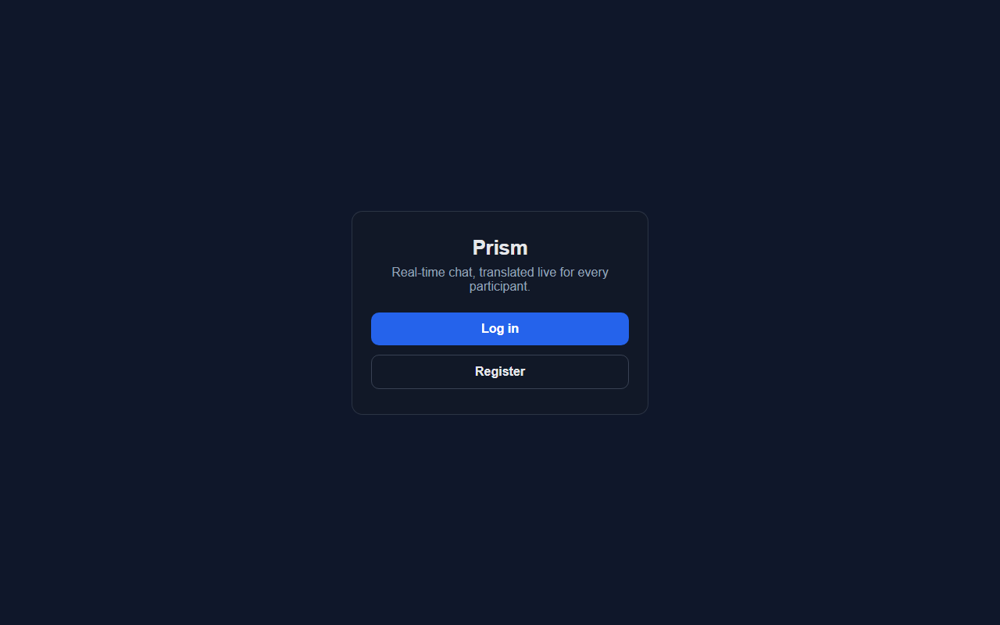

2. Enter an email, a username and a password.

   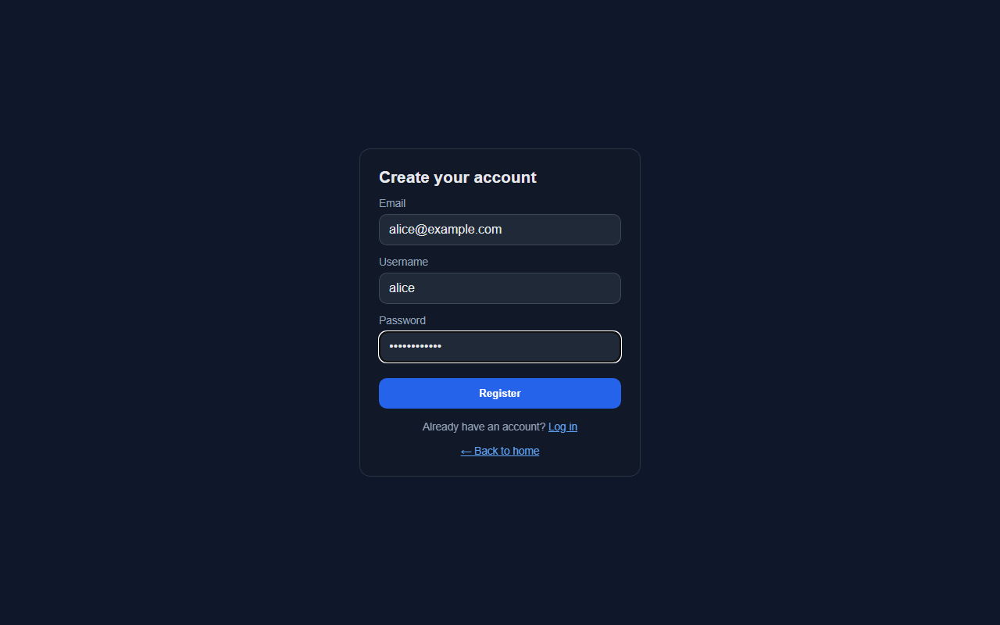

3. Click **Register**. After "Account created", you are redirected to the login page.

   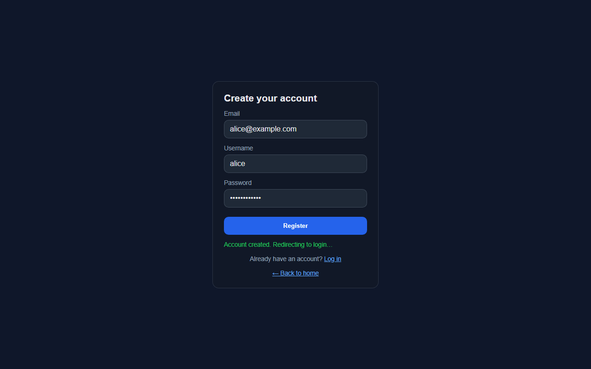

4. Open the verification email and click the link. You cannot log in until your email is verified. Links expire after 24 hours; on the login page, **Resend verification email** sends a new one. For the local Docker stack, emails are caught by Mailpit at http://localhost:8025.

If the email or username is already taken, an error is shown and you are sent to the login page.

## 2. Log in

1. Enter your username (or email) and password, then click **Log in**.

   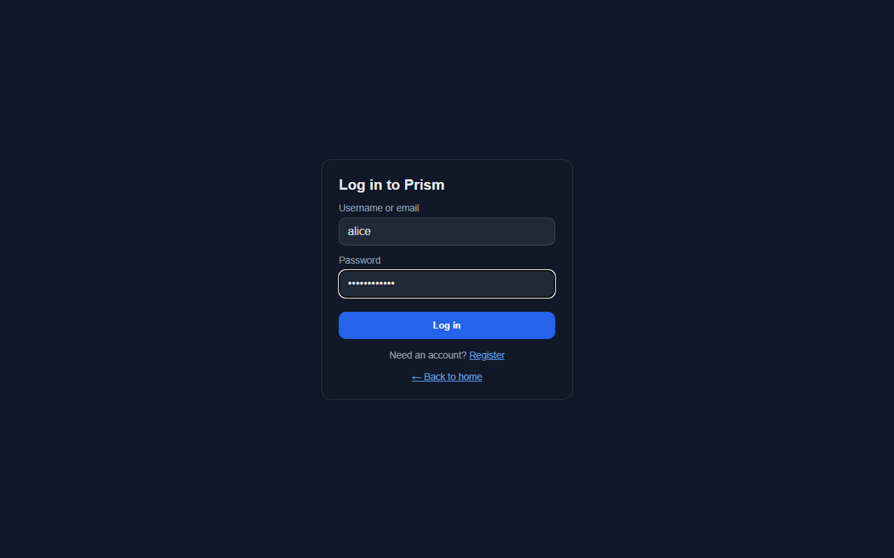

2. You land on the dashboard, which lists the rooms you own or belong to.

   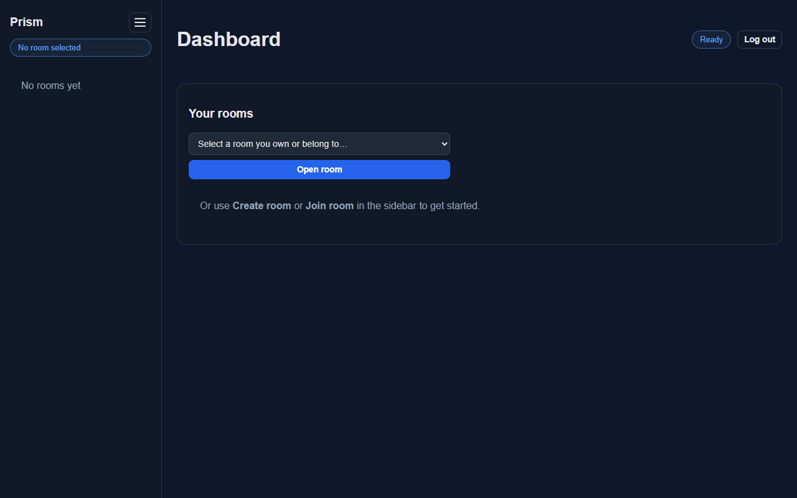

Notes:

- The default admin account must change its password on first login; a change-password form appears automatically.
- Use **Log out** in the top-right corner to end your session.

## 3. Create a room

1. Click the menu button (three lines) in the sidebar and choose **Create room**.
2. Enter a room name and **your language** (for example `en`), then click **Apply**.

   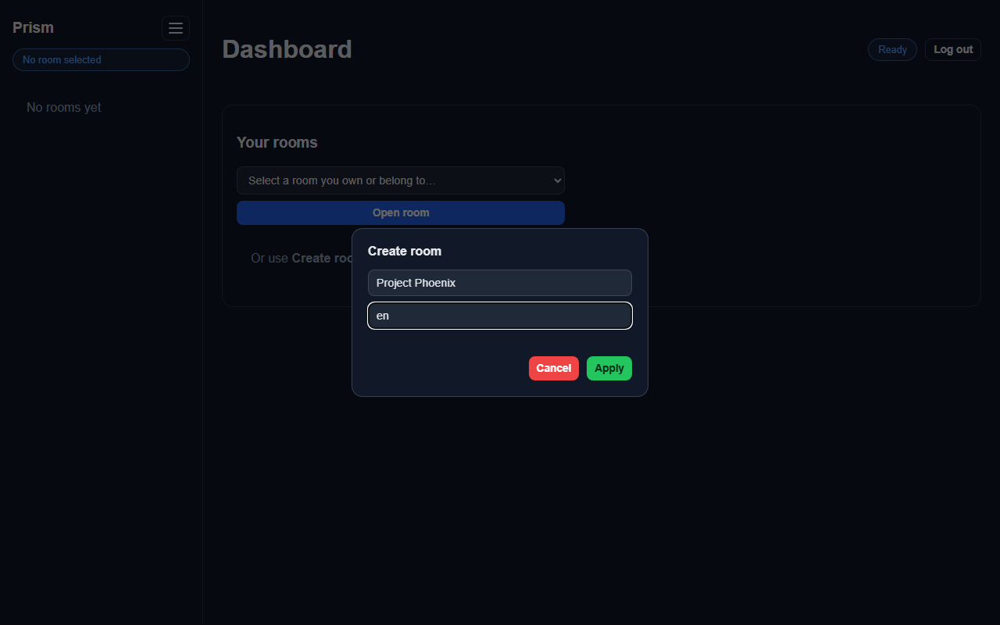

3. The room opens. Its **Room ID** is shown under the title; share it so others can join. As the owner you also see the **Add member** panel.

   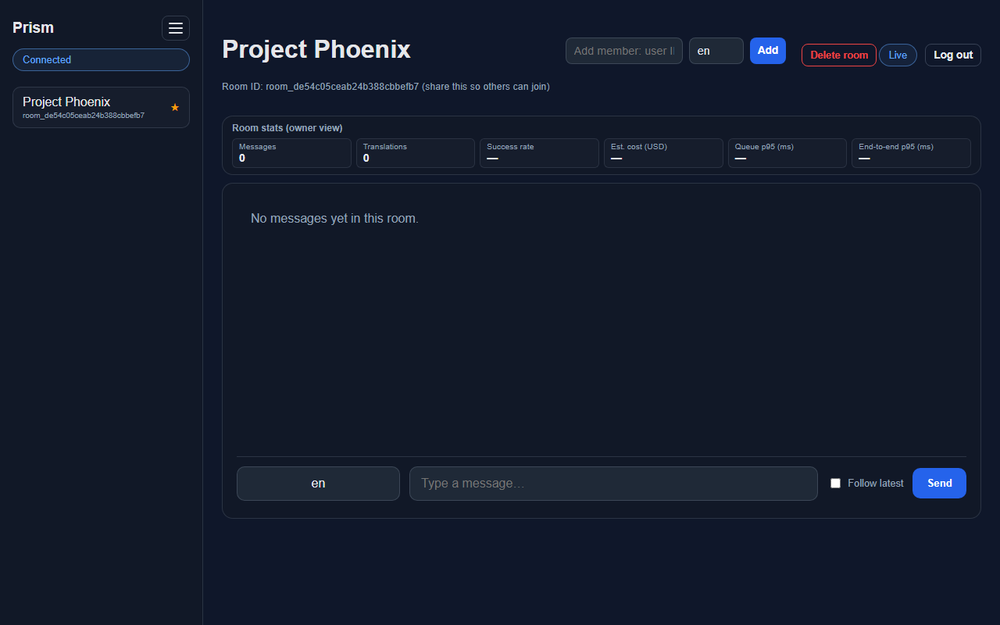

## 4. Add a user to a room

Only the room owner can add users. You need the invitee's **user ID**.

1. The invitee logs in, opens the menu and chooses **Settings**. Their user ID is shown there; they send it to you.

   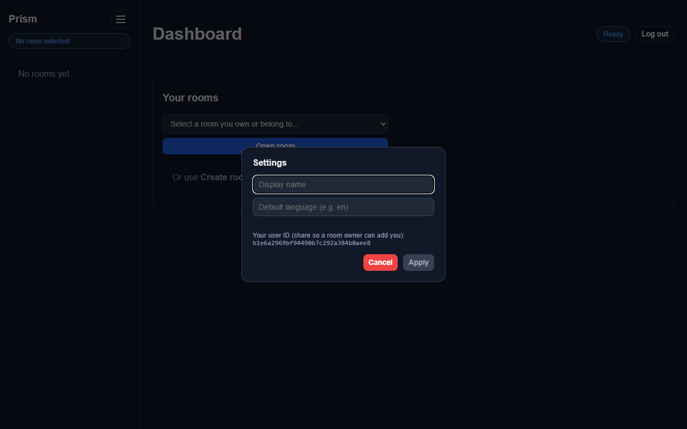

2. In the room, paste the user ID into **Add member: user ID**, set the invitee's language (for example `pl`), and click **Add**.

   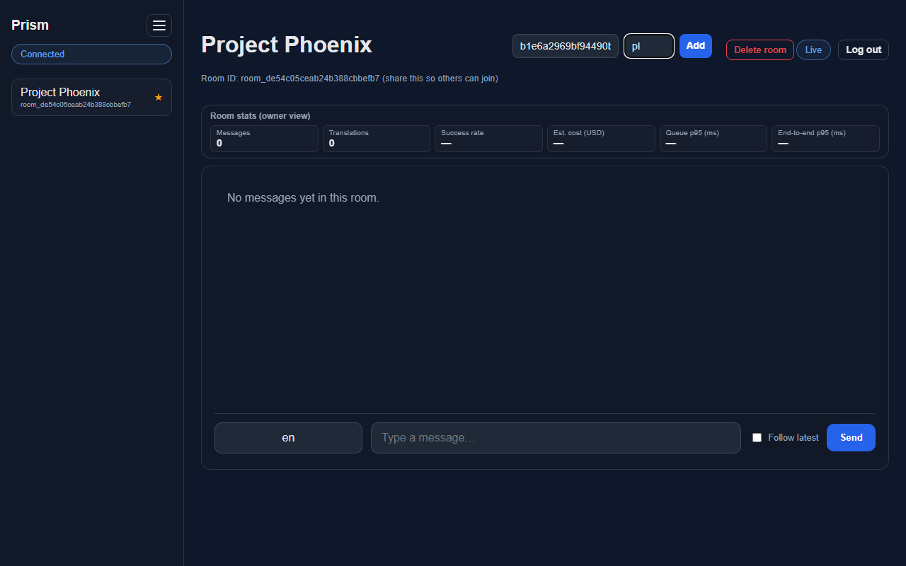

3. A confirmation appears under the form.

   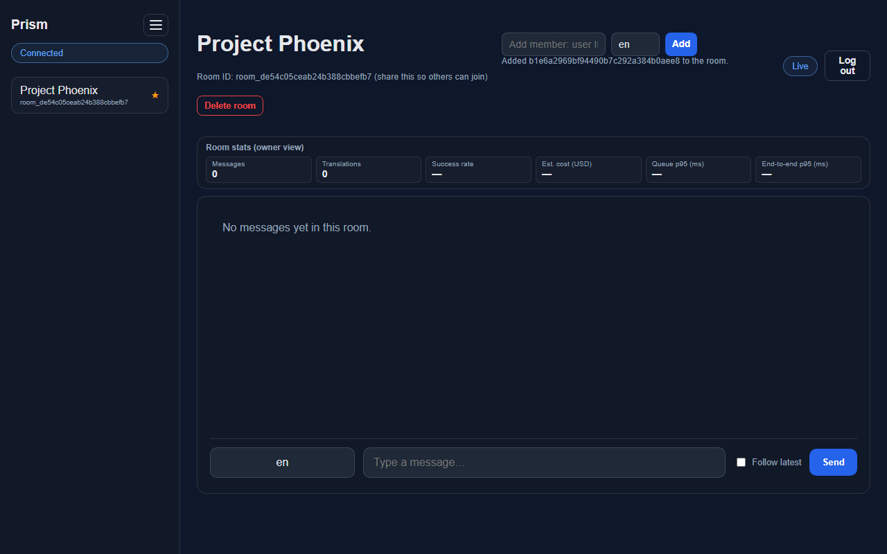

## 5. Join a room

Anyone with the Room ID can join.

1. Open the menu and choose **Join room**.
2. Enter the **Room ID** you received and your language (for example `de`), then click **Apply**.

   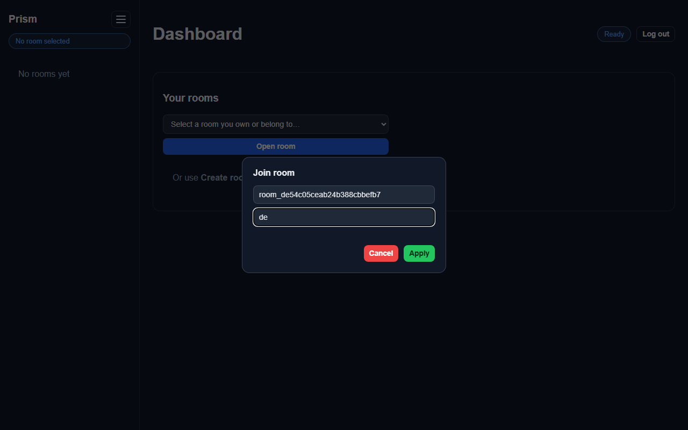

3. The room opens and you can send and read messages. Each message is shown in your own language.

   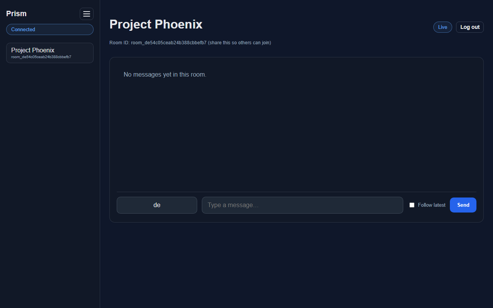

Rooms you belong to are listed in the sidebar and in the dashboard's room selector.

## Regenerating the screenshots

The images are captured by a Playwright script against the local stack:

```powershell
sh scripts/start-demo.sh
# one-time: install Playwright in any folder
npm install playwright; npx playwright install chromium
$env:NODE_PATH="<that folder>\node_modules"
node docs/user-guide/capture-screenshots.cjs
```

The register page posts to `REGISTRATION_SERVICE_URL`; set `REGISTRATION_SERVICE_URL=http://localhost` in `.env` when using the local Caddy proxy. Re-running the script reuses existing demo accounts and creates a new room. Newly registered accounts must be verified (via the link in Mailpit) before the script can log in as them.
