# Prism User Guide

Step-by-step guide to the Prism web app: registering, logging in, creating a room, adding a user and joining a room.

The examples use three demo accounts: **alice** (room owner), **bob** (added by Alice) and **carol** (joins with the room ID).

Open the app at `https://localhost` when running the local Docker stack (accept the self-signed certificate warning).

## 1. Register

1. Open the home page and click **Register**.

   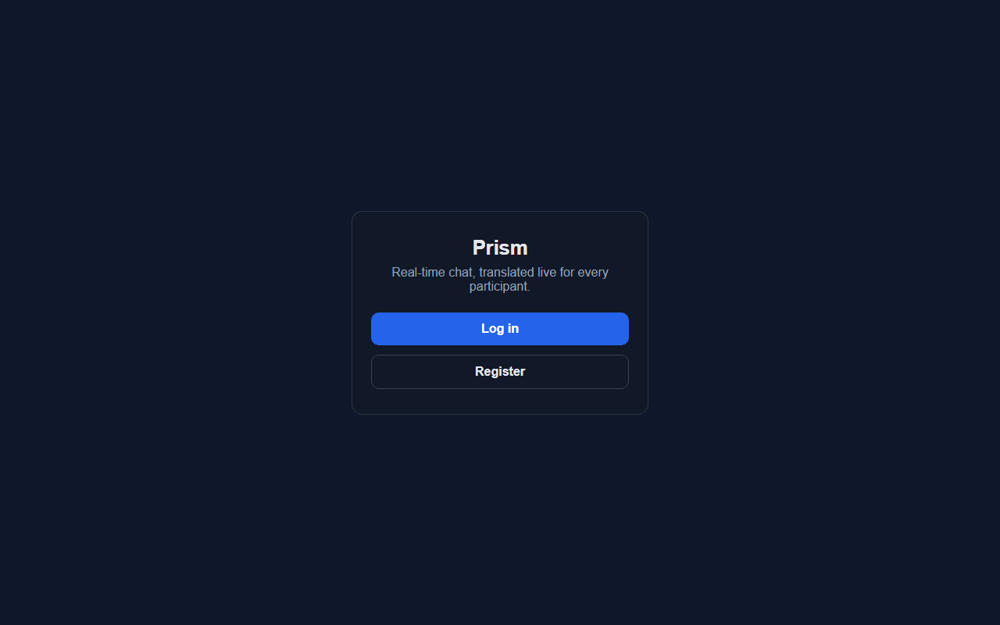

2. Enter an email, a username and a password.

   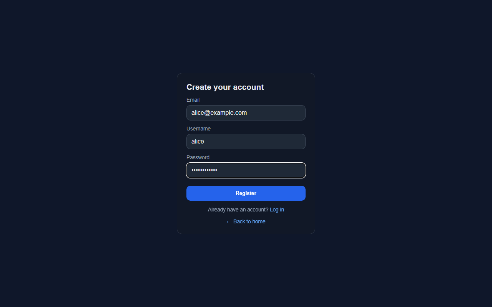

3. Click **Register**. After "Account created", you are redirected to the login page.

   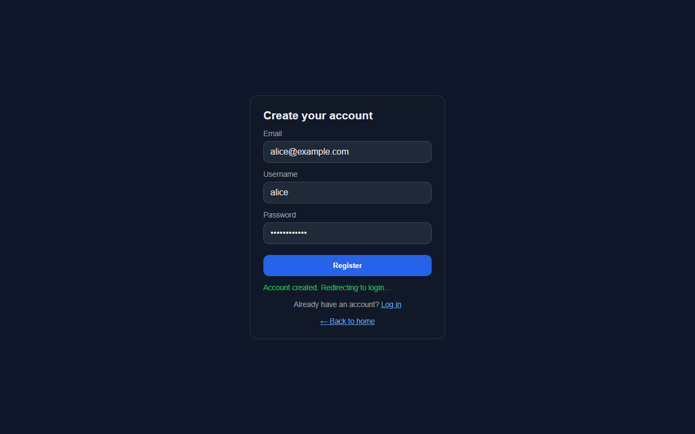

If the email or username is already taken, an error is shown and you are sent to the login page.

## 2. Log in

1. Enter your username (or email) and password, then click **Log in**.

   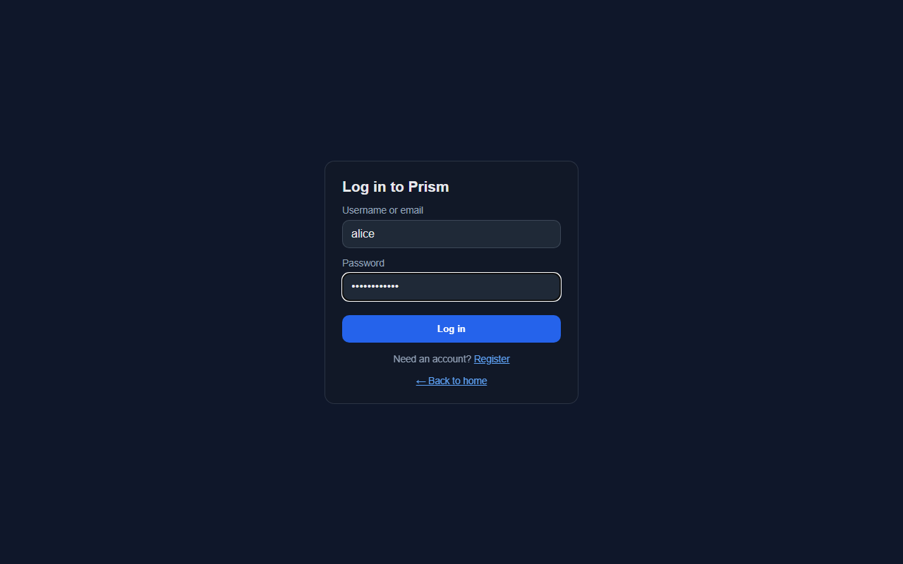

2. You land on the dashboard, which lists the rooms you own or belong to.

   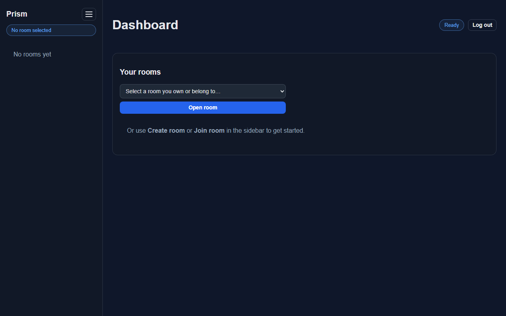

Notes:

- The default admin account must change its password on first login; a change-password form appears automatically.
- Use **Log out** in the top-right corner to end your session.

## 3. Create a room

1. Click the menu button (three lines) in the sidebar and choose **Create room**.
2. Enter a room name and **your language** (for example `en`), then click **Apply**.

   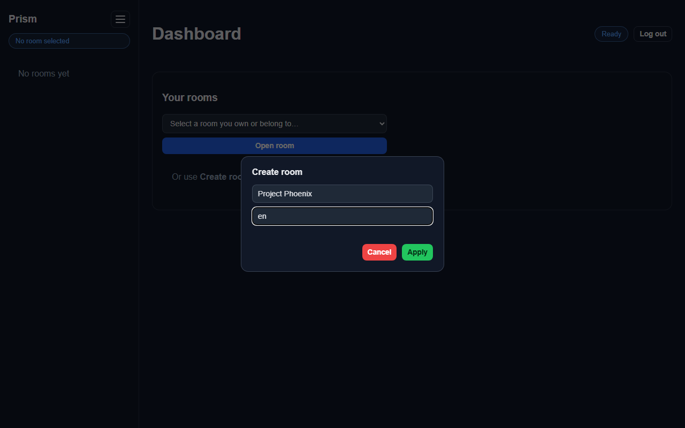

3. The room opens. Its **Room ID** is shown under the title; share it so others can join. As the owner you also see the **Add member** panel.

   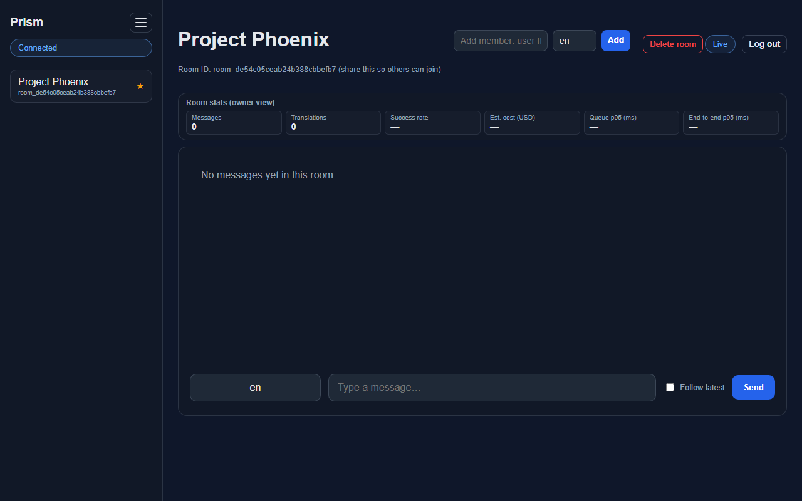

## 4. Add a user to a room

Only the room owner can add users. You need the invitee's **user ID**.

1. The invitee logs in, opens the menu and chooses **Settings**. Their user ID is shown there; they send it to you.

   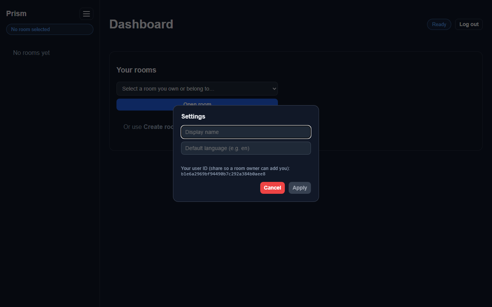

2. In the room, paste the user ID into **Add member: user ID**, set the invitee's language (for example `pl`), and click **Add**.

   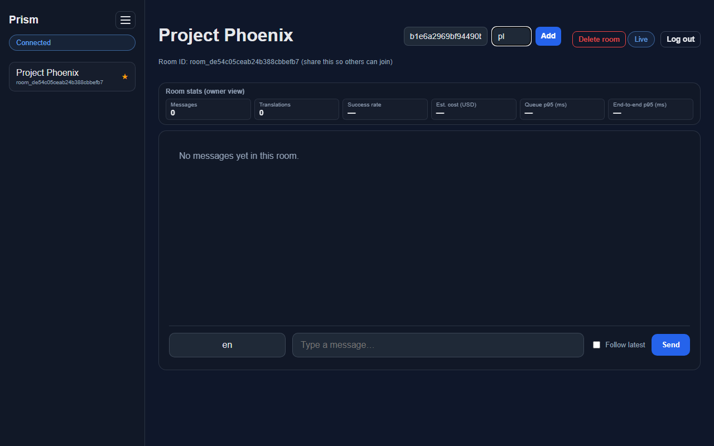

3. A confirmation appears under the form.

   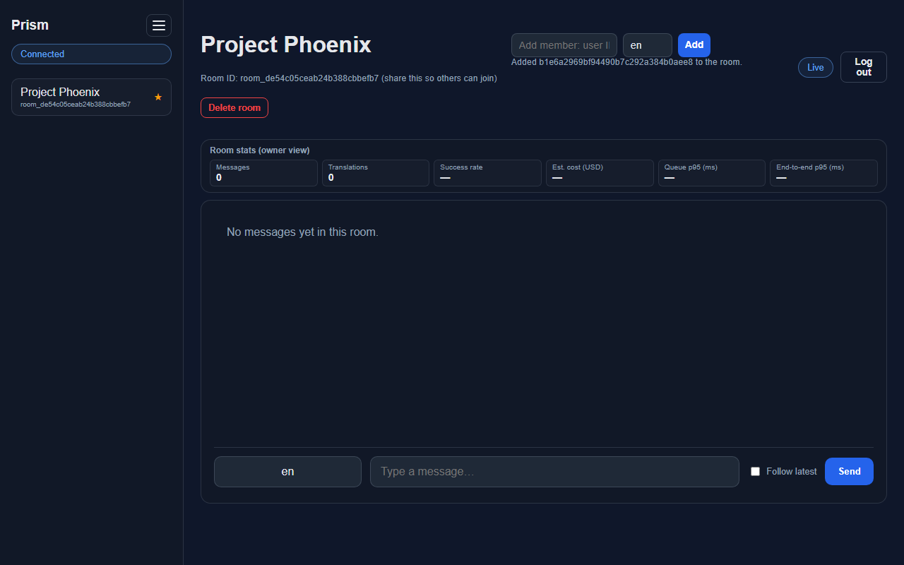

## 5. Join a room

Anyone with the Room ID can join.

1. Open the menu and choose **Join room**.
2. Enter the **Room ID** you received and your language (for example `de`), then click **Apply**.

   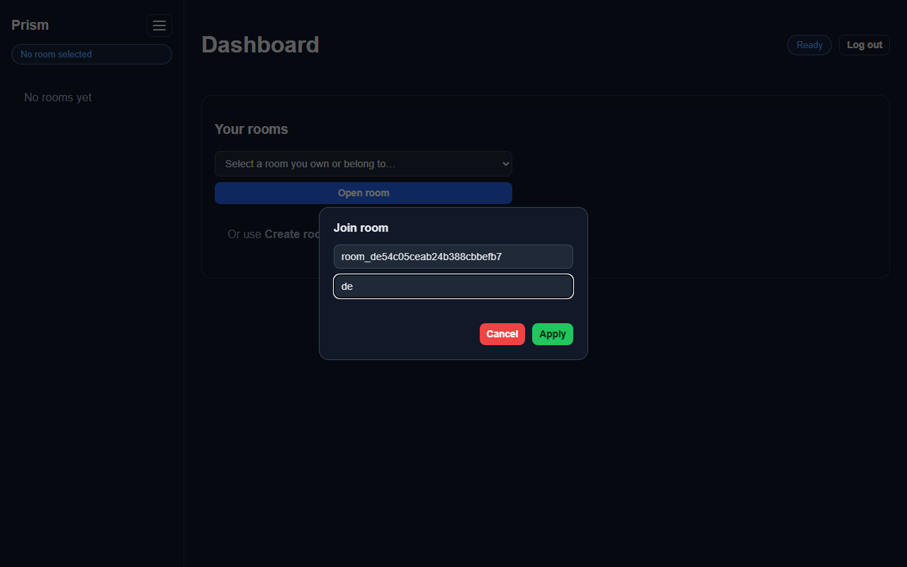

3. The room opens and you can send and read messages. Each message is shown in your own language.

   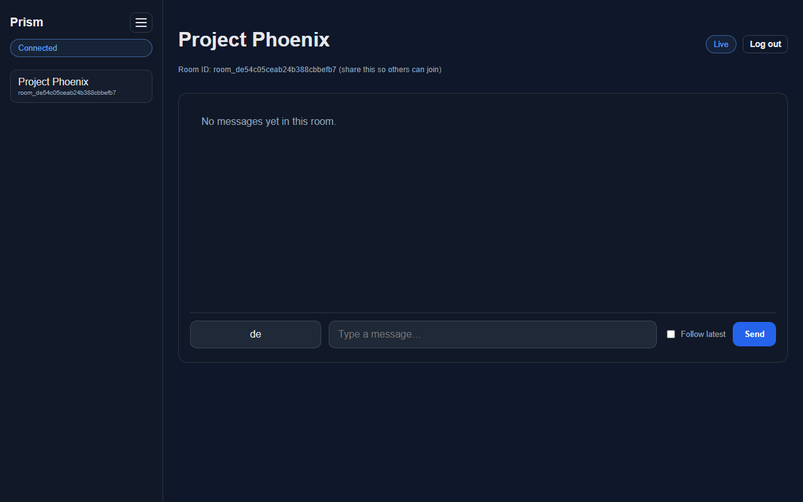

Rooms you belong to are listed in the sidebar and in the dashboard's room selector.

## Regenerating the screenshots

The images are captured by a Playwright script against the local stack:

```powershell
docker compose -f deploy/compose/docker-compose.yml up -d
# one-time: install Playwright in any folder
npm install playwright; npx playwright install chromium
$env:NODE_PATH="<that folder>\node_modules"
node docs/user-guide/capture-screenshots.cjs
```

The register page posts to `REGISTRATION_SERVICE_URL`; set `REGISTRATION_SERVICE_URL=https://localhost` in `.env` when using the Caddy proxy. Re-running the script reuses existing demo accounts and creates a new room.
